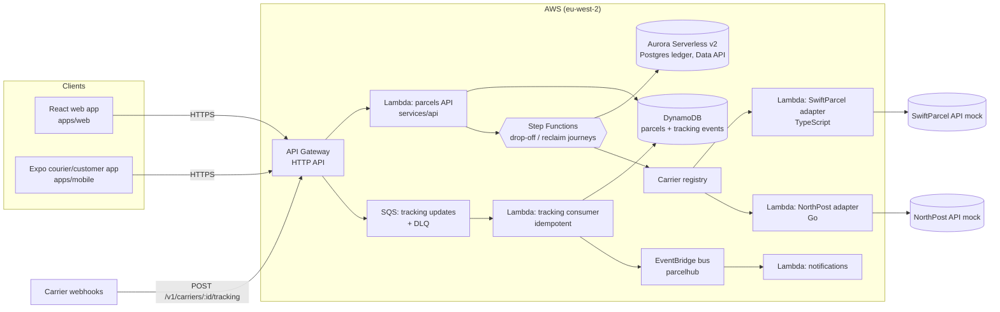

# ParcelHub

A cloud-native parcel services platform: drop-off and collection booking, carrier and service-provider integrations, transaction management, tracking updates and reclaim (returns) journeys.

It's built with **React, React Native (Expo), TypeScript, AWS CDK, Lambda, API Gateway, DynamoDB, Aurora Serverless v2, EventBridge, SQS, Step Functions, Go and GitHub Actions**.

> Status: week 1 of 8. See the progress table below. Every feature lands as a reviewed PR with tests passing in CI.

## Architecture (target)



Built so far (not deployed yet): an API Gateway HTTP API → `health` and `create-parcel` Lambdas, with no storage yet. The rest follows the [roadmap](#progress).

## Repository layout

| Path                    | What                                                                   |
| ----------------------- | ---------------------------------------------------------------------- |
| `apps/web`              | React + Vite + TypeScript booking app (Vitest + React Testing Library) |
| `apps/mobile`           | Expo app (placeholder until week 7)                                    |
| `services/api`          | Lambda handlers for the HTTP API                                       |
| `adapters/carrier-go`   | Carrier adapter contract and a Go implementation                       |
| `packages/shared-types` | Domain types and validation shared by every TypeScript package         |
| `infra`                 | AWS CDK app (TypeScript)                                               |
| `docs/adr`              | Architecture decision records                                          |
| `scripts/teardown.ps1`  | Destroys all stacks and lists leftover tagged resources                |

## Getting started

You need Node.js 22 or later, plus Go 1.22 or later for the adapter (from week 6).

```bash
npm install
```

```bash
npm test
```

```bash
npm run synth
```

```bash
npm run dev:web
```

`npm run synth` builds the CloudFormation template locally and doesn't need an AWS account. **Deploying** needs an AWS account with a budget alert already set. The stacks create no NAT gateways and set one-week log retention. Then run `npx cdk bootstrap` and `npm run deploy -w @parcelhub/infra`.

## Progress

| Week | Focus                                        | Status      |
| ---- | -------------------------------------------- | ----------- |
| 1    | TypeScript and the React booking UI          | In progress |
| 2    | CDK, API Gateway and Lambda                  | Planned     |
| 3    | DynamoDB single-table and Aurora ledger      | Planned     |
| 4    | Event-driven tracking, idempotency and DLQs  | Planned     |
| 5    | Step Functions drop-off and reclaim journeys | Planned     |
| 6    | Pluggable carrier adapters (TS and Go)       | Planned     |
| 7    | React Native (Expo) app                      | Planned     |
| 8    | CI/CD, observability and load testing        | Planned     |

## Decisions

See [docs/adr](docs/adr/README.md).
